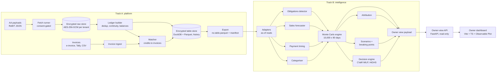

# Matsya

A cash-flow engine for Indian micro and small enterprises that sell on credit to larger buyers. It reads
the owner's bank account (through India's Account Aggregator network, with consent) and their invoices
(GST e-invoices, Tally, CSV). It simulates the next 90 days ten thousand times, and tells the owner, in
plain language:

- how likely their balance is to dip below the cushion they want to keep;
- which customers and bills are behind that;
- what the cheapest set of actions is that keeps them safe.

Every number on the owner's screen comes from that simulation. No language model writes or estimates any
figure.

This README is the full picture: the problem, the architecture, the maths, the dashboard and why it is
built the way it is, the evidence (losses included), how to run everything, and what is not done yet.

---

## Contents

1. [The problem](#1-the-problem)
2. [Why a simulation, and why the dashboard is simulated](#2-why-a-simulation-and-why-the-dashboard-is-simulated)
3. [Architecture](#3-architecture)
4. [Track A: the platform plane](#4-track-a-the-platform-plane)
5. [Track B: the intelligence plane](#5-track-b-the-intelligence-plane)
6. [The owner view: payload, API, dashboard](#6-the-owner-view-payload-api-dashboard)
7. [The dashboard, panel by panel](#7-the-dashboard-panel-by-panel)
8. [Rules the dashboard applies, and why](#8-rules-the-dashboard-applies-and-why)
9. [Evidence: what works, what does not](#9-evidence-what-works-what-does-not)
10. [Verification of the dashboard's figures](#10-verification-of-the-dashboards-figures)
11. [Running it](#11-running-it)
12. [Repository map](#12-repository-map)
13. [Data contracts](#13-data-contracts)
14. [Security and privacy](#14-security-and-privacy)
15. [Limitations](#15-limitations)
16. [Roadmap](#16-roadmap)
17. [Further reading](#17-further-reading)

---

## 1. The problem

An Indian MSME selling to larger companies lives on other people's payment habits:

- **The receivable is known; the payment date is not.** A Rs 10 lakh bill on 45-day terms may arrive
  in 30 days, in 120, or never.
- **Outflows are rigid.** Salaries go out on the 1st, rent and EMI follow, and PF, ESI, TDS and GST have
  statutory dates with interest and late fees attached.
- **Accounting software shows the past.** A ledger says what you have, not whether you will still have
  it on the 20th when GST is due.
- **The usual forecast is wrong in a predictable way.** It assumes every bill is paid on its due date.
  In the demo business that "naive" forecast puts the chance of running short within 90 days at
  **0%**. The truth, measured on 100 resampled futures, is **46%** (section 9).

The owner needs three answers, in order:

1. **Am I OK?** How likely is my balance to dip below the cushion I want to keep, and when?
2. **Who is the problem?** Which customers and which bills drive that risk?
3. **What do I do this week?** The cheapest actions that fix it, and what each one costs, including
   legal costs like MSMED interest.

---

## 2. Why a simulation, and why the dashboard is simulated

The word "simulated" applies twice. Both uses are deliberate.

### 2.1 Every figure is a simulation output

A cash forecast for an MSME is not one number. It is a distribution, because the biggest inputs are
uncertain:

- when each customer pays, and whether they pay at all;
- how much the business sells, and therefore what it spends on supplies and owes in GST;
- small, frequent, unscheduled flows.

A single "expected balance" hides exactly the thing the owner needs to know: the chance of a bad dip. So
the engine plays the next 90 days **10,000 times**. Each run draws:

- each customer's payment behaviour from what their own history says;
- future sales from the fitted sales process;
- supplier payments and GST that follow from those sales;
- fixed obligations on their detected dates;
- unscheduled flows resampled from history.

From those runs come:

| Output | Meaning |
|---|---|
| Daily percentiles (5, 25, 50, 75, 95) | The balance range on each day: the fan chart |
| Chance of a dip by day *t* | The share of runs that went below the cushion **on any day up to *t***, not only on day *t* |
| Expected shortfall | How deep the dips are, on average |
| Runway | The first day the chance of a dip passes 50% |

This is what makes the rest possible:

- **Actions can be priced in risk.** A TReDS discount, a chase call, an overdraft draw and a supplier
  stretch are all transforms of the same runs. Their effect on the chance of a dip is measured on the
  same random numbers, not guessed.
- **What-ifs are honest comparisons.** "Buyers pay slower" replays the same 10,000 futures with one change
  (common random numbers), so the difference is the change and not noise.
- **Breaking points come out of the same machinery.** For example, "you break if an unexpected bill of
  Rs 5.9 lakh or more arrives" is found by bisection over that same simulation.

### 2.2 The data behind the demo is synthetic, on purpose

The dashboard is seeded with a **synthetic business**: the generator's "borderline" preset, past seed 0,
as of 31 Mar 2026, with a Rs 10 lakh cushion. The reasons:

- **There is no Account Aggregator sandbox access.** Track A's fetch path is real (consent state machine,
  encrypted raw store, retries, idempotency), but its source is a folder of rendered ReBIT payloads, not
  a live AA.
- **Real MSME bank data cannot go into a demo.** Consent, purpose limitation and erasure are part of the
  product (section 14), so a public demo cannot carry anyone's real ledger.
- **A synthetic world has a ground truth.** The generator keeps past and future draws on separate seeds.
  For one fixed past it can resample the true future as many times as needed, which gives the *exact*
  chance of a dip to score the engine against. No real dataset offers that. It is why the benchmarks in
  section 9 can say "the truth was 46%".
- **The generator is honest about its limits.** A classifier tells generator invoices apart from real
  (Kaggle) invoices with an AUC of 0.999. The worlds test the mechanics, not realism, and the README says
  so wherever it matters.

The figures on the dashboard are therefore what the real pipeline computes on this synthetic business.
They are precomputed into JSON files and served by a small API. A nightly job will replace these files
per tenant (section 16).

### 2.3 What is real and what is simulated

| Part | Status |
|---|---|
| Simulation engine, payment-timing model, sales forecaster, obligations detector, decision engine, scenarios, attribution | **Real code**, run end to end to make the payload |
| Every figure on the dashboard | **Real output** of that code, on the synthetic business |
| The business itself (bank lines, invoices, buyers) | **Synthetic**, from the generator |
| Account Aggregator fetch | **Stub source**: a folder of rendered payloads through the real fetch runner |
| Nightly refresh | **Not built**: payloads are precomputed files |
| Automation buttons (reminders, MSMED notice, Samadhaan filing, TReDS, supplier request) | **Presentation only**: drafts use real figures, but nothing is sent, and every notification is tagged "Demo" |

---

## 3. Architecture

### 3.1 Two tracks, one contract

The system is split into two planes that share only a data contract:

- **Track A, the platform plane** (`platform/`, `eval/platform/`): everything that makes data trustworthy.
  It covers consent, fetch, encrypted storage, the ledger, invoice ingest, the payment matcher and the
  export.
- **Track B, the intelligence plane** (`intelligence/`, `eval/models/`): everything that turns trusted data
  into forecasts and decisions.
- **`contracts/`** (`matsya_contracts` 0.1.0): the only shared code. It holds one pydantic row model per
  table, Polars schemas derived from them, the ID functions and the enums.

Neither track imports the other. Each namespace has exactly one writer:

| Writer | Namespaces | Tables |
|---|---|---|
| Track A | `ops`, `raw`, `ledger`, `labels`, `ref` | consents, events, quarantine, owner inputs, raw AA payloads, transactions, balances, invoices, matches, invoice outcomes (payment labels), buyers |
| Track B | `features`, `forecast`, `decisions` | transaction categories, obligations, invoice timing, sales process, forecast runs, balance quantiles, shortfall, calibration and shock state, plans, drivers |

### 3.2 Data flow



### 3.3 The run, end to end

1. **Track A pipeline** (`python -m matsya_platform.pipeline -c pipeline.toml run`), per tenant with an
   active consent:
   1. expire consents;
   2. fetch new AA payloads into the encrypted raw store;
   3. build the ledger;
   4. refresh the reference tables;
   5. ingest new invoice files;
   6. match bank credits to invoices.

   Then one export of every Track A table as `<namespace>.<table>.parquet` with a sha256 manifest. The run
   is idempotent and locked: run it twice and the second writes nothing.
2. **Track B** reads that export directory (`DATA_SOURCE: contract`), validates every table against the
   contract, and writes its own tables (`python -m matsya_intelligence.run`).
3. **Owner view**: `compute_tenant_run` runs the decision engine, the baseline, every scenario preset with
   its breaking point, and attribution, all on common random numbers. `build_owner_view` turns that into
   one JSON payload (`owner-view-v1`).
4. **API** (`platform/src/matsya_platform/api/app.py`) serves precomputed payloads. No engine runs on a
   request.
5. **Dashboard** (`dashboard/owner`) fetches the payload. A pure view-model turns it into what the owner
   sees.

Today step 3 is run by `eval/models/owner_view_demo.py` on the synthetic business. Running it per tenant
every night, from steps 1–2, is the main piece of work left (section 16).

---

## 4. Track A: the platform plane

Track A's job is that every rupee Track B sees is right, or flagged. Built and tested:

| Component | What it does | Notes |
|---|---|---|
| **Consent** (A1) | State machine over pending, active, paused, revoked and expired. Every change is logged as an event; a terminal state triggers erasure. | No AA consent notifications yet: `consent grant` stands in for the owner's approval |
| **Fetch** (A2) | Runner with retries, backoff, idempotency by payload sha256, and a discard on consent change mid-fetch | The source is `LocalFolderAdapter`; a real AA client replaces that one class |
| **Raw store and keys** (A3) | Every payload byte encrypted per tenant (AES-256-GCM, tenant key wrapped under a master key with RFC 3394) | The master key comes from the environment; the store refuses to start without it |
| **Ledger builder** (A4) | Parses ReBIT deposit payloads into one deduplicated transaction list per account, with bank-reported and reconstructed balances, quarantine of bad rows, and coverage. Money is integer paise. | A balance-continuity break fails the batch; everything else is flagged, not dropped |
| **Invoice ingest** (A6) | Three adapters (GST e-invoice JSON, Tally day book, generic CSV) feed one core: invoice id, fiscal year, terms, buyer resolution (GSTIN, PAN, exact or fuzzy name), duplicates | The Tally and e-invoice layouts have not been checked against real files |
| **Matcher** (A6) | Links bank credits to invoices, allowing for TDS, part payments, bundles and TReDS. Writes payment-timing labels. | Cascade: reference, exact amount, TDS-explained, part payment, bundle, TReDS, habit learning, margin-based confidence. Ambiguous cases go to review rather than being guessed |
| **Table store** | Every table encrypted per tenant (Parquet modular encryption written by DuckDB), with history. Local disk or MinIO. DuckDB reads encrypted parts in place, so no plaintext file is written. | `read(..., as_of=t)` returns what the store held at *t*, so exports are reproducible |
| **Erasure** | Revoking the last consent destroys the tenant key and removes their table parts | Proven by a test that tries every stored object under regenerated and foreign keys; all fail |
| **Export** | Every Track A table, validated row by row, with a sha256 per file and the store time | Track B's reader opens exactly these files |
| **Owner-view API** | `GET /tenants/{id}/owner-view`, `GET /evidence/naive-vs-ours`, `GET /health` | Read-only. No auth yet (section 14) |

**Matcher quality** on generator worlds with no injected faults (from `docs/track-a-state.md`):

- precision **1.000**;
- recall **0.948–0.991**;
- review share under 5.2%;
- every TDS rate and basis right on accepted links.

The baseline "exact gross amount" matcher reaches a recall of 0–0.16. The fault-injection sweep finds no
single fault that turns the ledger silently wrong at any rate. Combined faults first do so at 50–75%
injection.

---

## 5. Track B: the intelligence plane

Track B's production path is `python -m matsya_intelligence.run`. Every component reads Track A's tables
only through as-of adapters, so a forecast never sees data from after its as-of date.

### 5.1 Components

| Component | Method | Output |
|---|---|---|
| **Categoriser** | 21 rules (keywords, rails, GSTINs, amount size, recurring debits, repeat counterparties) combined by majority vote. The LLM step is a stub that always abstains. | A category for every bank line |
| **Obligations detector** | Statutory calendar (TDS on the 7th, PF/ESI on the 15th, GSTR-3B on the 20th) plus recurrence detection (7/14/30/90-day periods, median amount, confidence from spread) | Salary, rent, EMI, fees, TDS, PF, ESI, GST dates and amounts |
| **Payment-timing model** | Per buyer, a two-phase Beta-geometric with a never-paid share: a chance of paying each week before the due week and another from it on, with a probability of never paying. Fitted by Gibbs sampling, with shrinkage to sector/type groups and empirical weekly hazards for buyers with 8+ paid bills. | When each open and future bill is paid, or whether it is never paid |
| **Sales forecaster** | Negative-binomial weekly invoice counts; amounts and terms resampled from each buyer's history; purchase lag and ratio; GST as 18% of (taxable sales − taxable purchases) with carry-forward; a 4-week block bootstrap for parameter uncertainty | Future sales, supplier payments, GST |
| **Sector shocks** | Weekly lateness per sector, AR(1) Kalman filter fitted by grid search | Correlated slowdowns across buyers in a sector |
| **Simulation engine** | 10,000 paths × 90 days, combining all of the above | Balance paths, percentiles, chance of a dip, expected shortfall, runway |
| **Calibration** | Adaptive conformal inference for days 1–30: bands widen after misses and narrow after hits | Calibrated near-term bands (needs history; the demo has none) |
| **Scenario engine** | Seven typed transforms (rate multiplier, date shift, invoice cash, cash event, terms change, freeze, order multiplier), run on common random numbers, with breaking-point bisection | What-ifs and "you break if…" |
| **Decision engine** | Actions as transforms with exact costs (TReDS discount, chase, overdraft draws, supplier stretch with MSMED interest and the 43B(h) deduction delay). Solved as a MILP with HiGHS and checked on fresh paths. | The plan |
| **Attribution** | Neutralise one bill or buyer at a time on the same random numbers; measure how much risk goes away | Drivers of the risk |

### 5.2 The core definitions

With $B^{(n)}_t$ the balance on day $t$ in run $n$, $N$ runs and cushion $\theta$:

$$p_{\text{short}}(t) = \frac{1}{N}\sum_{n} \mathbf{1}\Big[\min_{s \le t} B^{(n)}_s < \theta\Big]$$

It is the share of runs that have been below the cushion on any day up to $t$. It never decreases with
$t$. Runway is the first $t$ where it reaches 0.5. The fan chart is the 5th, 25th, 50th, 75th and 95th
percentile of $B_t$ across runs, day by day.

**Payment timing.** An invoice from buyer $b$ is paid in week $w$ with chance $p^{\text{early}}_b$
before its due week and $p_b$ from it on. With probability $\pi_b$ it is never paid. All three have Beta
posteriors. An open bill that has survived $c$ weeks is "dead" with probability
$\pi / (\pi + (1-\pi)S(c))$.

### 5.3 The decision engine

The default plan is a **CVaR plan** (Rockafellar–Uryasev). On 1,000 subsample paths, with the loss on a
path being the depth of its worst dip below the cushion:

$$\min_x \sum_a c_a x_a \quad \text{s.t.} \quad u_n + \eta + \sum_v \delta_v[n,t]\,x_v \ge \theta - B[n,t],\quad \eta + \frac{1}{\alpha N}\sum_n u_n \le \text{budget}$$

Here $\alpha = 0.05$ and the budget is Rs 0. Only the actions are integer. If the budget cannot be met,
it minimises the CVaR, then finds the cheapest plan within 0.1% of that minimum.

The alternative, a **chance-constrained plan**, minimises cost subject to at most
$\lfloor 0.8\,\varepsilon N \rfloor$ paths short. Either way the chosen plan is re-run on **10,000 fresh
paths** against the same-seed baseline, and only those fresh-path figures are shown as "before and
after".

**Why CVaR is the default** (30 worlds, `docs/results-summary.md`):

- it meets the owner's 5% target strictly in **30/30** worlds, against 19/30 for chance-constrained;
- the average depth of the worst 5% of dips falls from Rs 6.1 lakh to Rs 0.96 lakh;
- it solves in 1.4 s median, against 31 s;
- under a stress test (payments × 0.85, orders × 0.9) it still meets the target in 27/30 worlds, against
  0/30.

The price is that it is dearer: Rs 1.16 lakh against Rs 0.54 lakh mean plan cost.

**MSMED law is in the costs.** A supplier stretch past the s.15 limit (written terms capped at 45 days,
else 15) costs the penalty, plus compound interest at three times the RBI bank rate with monthly rests
(bank rate per month, as a dated series), plus the tax cost of the 43B(h) / s.37(2)(g) deduction moving
to a later year. Money customers owe the owner under the same Act is reported separately. It is not a
plan action, because its cash lands on the claim day and cannot fix an earlier dip.

---

## 6. The owner view: payload, API, dashboard

```
compute_tenant_run ──► build_owner_view ──► owner_view.json ──► API ──► dashboard view-model ──► page
 (engine, plan,          (owner-view-v1:       (precomputed)     (read-     (viewmodel.ts:
  scenarios,              headline, fan,                          only)      every sentence
  attribution)            risk by day, plan,                                 and figure)
                          drivers, what-ifs,
                          owed, meta)
```

- **The payload** (`intelligence/src/matsya_intelligence/present/owner_view.py`) holds every figure as a
  typed field. Track B's test checks that any number in its own template strings also exists as a field.
- **The obligations payload** (`eval/demo/obligations.json`, schema `obligations-v1`) is made by
  `dashboard/owner/precompute/obligations.py`. That script calls Track B's public functions only, without
  changing them. It reruns the owner view's own baseline (same seed), so its figures match the owner view
  exactly. The dashboard uses it only when its tenant, run and as-of date all match the owner view.
- **The API** re-reads files when they change, so replacing a payload updates the page on refresh.
- **The dashboard** (`dashboard/owner`, Vite + TypeScript + Observable Plot) has no framework. All logic
  is in `src/viewmodel.ts` and `src/automations.ts`: pure functions from payload to screen, with 74 unit
  tests. The rendering code (`owner.ts`, `charts.ts`, `actions.ts`) does no maths and writes no wording.
  When the API is down, the page falls back to the payloads bundled at build time.

---

## 7. The dashboard, panel by panel

The page is a dashboard, not a report: an app bar, a row of KPI tiles, then panels in a two-column grid.

| Panel | What it shows | Source |
|---|---|---|
| **App bar** | Data freshness ("bank data complete up to 29 Mar 2026"), as-of date, a link to the evidence page, the demo notifications bell | `meta` |
| **KPI: chance of a dip** | The chance of dipping below the cushion by the chosen day (default 30 days), as a percentage range; the status badge; "→ On track with the plan" | `risk_by_day`, `plan` |
| **KPI: in the bank today** | Today's balance | `headline.balance_today` |
| **KPI: likely balance** | The middle half of runs on the chosen day, and the typical (median) balance | `fan` |
| **KPI: overdue from customers** | Total overdue across all customers | `owed`, `drivers` |
| **Simulation explorer** | The balance chart (typical outcome, likely range, cushion, big payments), what-if chips, a day slider with Play, and a bar showing where the 10,000 runs land on the chosen day | `fan`, `what_ifs` |
| **This week** | The plan as tasks: before → after (fresh-path), each step with its cost and its catch, a "Do this" button, and optional steps collapsed | `plan` |
| **Your obligations** | Every payment due in the next 30 days (60 more behind a toggle): amount, whether it can move (fixed by law / keep on time / can ask), and how tight its day is | obligations payload |
| **What you can do** | Suggestions worked out from obligations, customers and the law (section 8.7) | obligations payload, `owed`, buyer rows |
| **Who owes you** | One row per customer: outstanding (with bar), overdue, usual lateness, "slow payer", bills that may never be paid; Remind and MSMED notice buttons | `owed`, `drivers` |
| **Be ready for** | The 2–3 most damaging breaking points, in rupees, days, or "takes 15% longer to pay" | `what_ifs` |

### 7.1 The simulation explorer drives the dashboard

Picking a what-if or moving the day slider updates every figure that was actually simulated:

| Element | Follows the controls? | Why |
|---|---|---|
| Chance of a dip, its status badge, likely balance | Yes, exactly | Each what-if carries its own daily percentiles and chance of a dip |
| Chart and "where the runs land" bar | Yes, exactly | Same |
| In the bank today, overdue total, customer table | No | They are facts about today |
| The plan, breaking points, how tight each obligation day is | No; they show a note | They were computed for things as they are only. Showing them as if re-solved would be a guess |

A black "If: buyers pay slower" tag marks every figure that belongs to a what-if.

### 7.2 Demo automations

The buttons are for presentation. Nothing is sent. Every dialog says so and every notification carries a
"Demo" tag:

| Button | Draft | Simulated follow-up |
|---|---|---|
| **Remind** (per customer) / **Remind all overdue** | A message (WhatsApp / Email / SMS) with that customer's own overdue total, oldest bill and MSMED interest | Sent → delivered → read |
| **MSMED notice** (customers who owe interest) | A formal notice listing every late bill (amount, days late, interest), citing ss. 15, 16 and 18 and the 45-day limit, marked "a draft to check, not legal advice", with a warning that it can strain the relationship | Notice sent → filed on MSME Samadhaan (a `DEMO-SAM-` reference) → acknowledgement (the Council decides within 90 days) |
| **Do this** (plan steps) | Supplier request (with the MSMED warning for MSME suppliers), TReDS listing (payout = bill − fee), overdraft draw request, customer reminder | Matching replies, bids, acknowledgements |
| **Remind me** (statutory payments) | — | A reminder two days before the due date |

Drafts use placeholders for what the payload does not hold: `[Your business name]` and
`[Udyam registration number]`.

---

## 8. Rules the dashboard applies, and why

### 8.1 The status

One constant (`STATUS_RULES` in `viewmodel.ts`) defines the four states. They are checked in order:

| State | Rule | Meaning |
|---|---|---|
| **Act this week** | 30-day chance ≥ 50%, or runway within 30 days | A dip this month is more likely than not |
| **Needs attention** | 30-day chance above the owner's target, or 90-day chance ≥ 50% | Above tolerance |
| **Keep an eye on it** | Within target for 30 days, above it for 90 | Risk builds later |
| **On track** | 90-day chance within target | Within tolerance even over three months |

The target is the owner's (the plan's 5% by default). The 90-day chance is never taken as less than the
30-day one, so the states cannot contradict each other. The status leads with 30 days because that is
where the engine is measured to beat a flat forecast. At 90 days it loses (section 9).

The demo business is correctly "Needs attention": its 30-day chance is 19.6% against a 5% target. With
the plan, the fresh-path check gives 0% by day 30 and 0.1% by day 90, which is "On track". The tile shows
that path out directly under the badge.

### 8.2 Chances are shown as percentage ranges, widened upward

- **Below 2%: "under 2%".** The engine under-predicts low risks, so finer figures would claim precision
  it does not have.
- **2% to 50%: a range.** The low end is the estimate; the high end is 1.5 × the estimate (rounded to 5
  from 10% up). On 100 generator pasts, the true chance in the 0.05–0.20 band was about 1.7 times the
  estimate. On the demo business the engine says 33.7% for 90 days against a true 46%. Showing "20–30%"
  instead of "20%" is the honest presentation.
- **50% and above: one figure** ("about 70%"). **Above 95%:** "over 95%".
- **No "1 in N" formats.** Research on the 1-in-X effect shows that format makes risks feel larger and
  distorts comparisons, most at low risk.

### 8.3 No alarm on a low day

When the chosen day reads "under 2%", the tile drops the red "Needs attention" badge, because it would
contradict the figure. The month's risk still matters, so the tile says where the chance rises to (for
example "Rises to 20–30% by 30 Apr"). In the demo, this applies to days 1–4 only.

### 8.4 Slowdowns as time, not hazards

A what-if that multiplies every buyer's weekly chance of paying by $m$ stretches the average wait by
$1/m$. That is exact for a constant weekly chance (a geometric wait with mean $1/h$ becomes $1/(mh)$),
and close for the engine's per-week chances. So a breaking multiplier of 0.867 reads "customers take about
15% longer to pay", and a factor of 0.5 reads "twice as long".

### 8.5 The plan: only fresh-path figures are shown

Each step's "risk after" in the payload is added up step by step on the fresh paths. That is an additive
approximation; only the last step is a full re-run. The dashboard uses those figures only to group steps
and never shows them:

- steps up to the first one that meets the target are the to-dos;
- the rest are optional;
- the before and after shown are the whole plan's fresh-path figures.

### 8.6 Customers: no risk shares

Attribution removes one driver at a time, and the drivers overlap. In the demo, the ten contributions add
up to 1.29 against a total risk of 0.34, and one buyer appears both as a bill and as a buyer. Any bar or
percentage per driver would be false. So "Who owes you" shows one row per customer, sorted by rupees at
stake, and uses attribution only for:

- "slow payer": a buyer-level driver;
- bills that may never be paid: never-paid chance ≥ 0.9 reads "already left out of your forecast", and
  0.5–0.9 reads "counts on only part of it".

### 8.7 Obligations and suggestions

- **Statutory payments** (GST, TDS, PF, ESI) are "fixed by law", and the page never suggests moving them.
  It says paying late adds interest and late fees, without a rate, because none is verified in the
  constants file.
- **A day is "tight"** when more than the owner's target share of runs end that day below the cushion.
- **Suggestions are generated in this order:**
  1. the tightest day, with the largest overdue customer to collect from first;
  2. the biggest tight statutory payment to set money aside for;
  3. up to two movable payments (rent, EMI, fees) on tight days, each flagged "the forecast has not
     tested this move";
  4. supplier payments, with the 45-day MSMED limit;
  5. MSMED interest customers owe the owner.

### 8.8 Other rules

- **MSME supplier warning.** A stretch costing more than the Rs 2,000 penalty means the decision engine
  added MSMED interest, so the supplier is micro or small. This is marked `DEMO HEURISTIC` in code and
  listed as a payload gap.
- **Big payments out.** A day-on-day fall in the typical balance of at least 20% of today's balance gets
  a ▼ marker. In the demo, these are salaries (Rs 12 lakh on the 1st) and GST.
- **Horizons.** A what-if whose required horizon was not computed is hidden. "Orders fall" needs 180 days,
  the payload ran 90, and at 90 days fewer orders *lower* the risk, a misleading lesson.
- **Graceful degradation.** A missing field hides its element. Nothing is guessed.
- **Copy rules.** No "hazard", "quantile", "CVaR", "p_short", "runway", "bin" or "points" anywhere on the
  page. A test checks every string.

---

## 9. Evidence: what works, what does not

All from `docs/results-summary.md` and `eval/results/`. Every result has a baseline and an n.

**Wins**

| Benchmark | Ours | Baseline | n |
|---|---|---|---|
| Naive vs ours, median balance error at day 30 | Rs 3.8 lakh | Rs 84.7 lakh (naive) | 30 worlds, 30/30 better |
| Naive vs ours, error in the 90-day chance of a dip | 0.089 | 0.267 | 30 worlds, 26/30 better |
| Real shortfalls flagged at chance ≥ 20% | 16/20, 0 false alarms | 11/20 (naive) | 30 worlds |
| Payment timing, C-index (Kaggle invoices) | 0.741 | 0.601 (due date) | 5,955 invoices |
| Payment timing, integrated Brier | 0.027 | 0.052 (due date) | 5,955 |
| Sales counts, log score | −4.41 | −6.54 (Poisson) | 90 weeks |
| Replay, 7–30-day balance MAE | 0.73–0.76 × flat | flat forecast | 180 days, 3 worlds |
| CVaR plan, owner target met on fresh paths | 30/30 | 19/30 (chance-constrained) | 30 worlds |
| Engine vs oracle, true-parameter mode | max \|z\| = 2.1 | within Monte Carlo error | 9 checks |

**Losses and failures, stated plainly**

| Benchmark | Ours | Baseline | What it means |
|---|---|---|---|
| Payment timing, C-index | 0.741 | Cox 0.770, LightGBM 0.754, random survival forest 0.785 | Tree and survival models rank better |
| Replay, 90-day balance MAE | 1.32 × flat | flat forecast | The 90-day middle line is biased up; on the demo world by about Rs 7 lakh |
| 90% band at 60–90 days | 0.80–0.82 coverage | 0.90 target | Too narrow late in the window |
| Low-risk calibration (0.05–0.20 bin) | 0.126 predicted | 0.214 true | Low risks under-predicted; hence the widened ranges |
| Berka loans, outside check | AUC 0.639 | 0.808 (balance-only logistic regression) | On real bank data, a simple balance model predicts loan default better |
| Sales 80% interval coverage | 0.97 | 0.80 target | Too wide |
| Attribution, buyer that slowed down recently | not ranked first | — | No change-point detection |
| Generator realism | AUC 0.999 | 0.5 = realistic | Synthetic invoices are easy to tell apart from real ones |

**Demo business, ours vs naive vs truth** (borderline, seed 0, Rs 10 lakh cushion):

| | 90-day chance of a dip | Typical balance, day 30 | Typical balance, day 90 |
|---|---|---|---|
| Truth (100 resampled futures) | 46% | Rs 34.5 lakh | Rs 45.0 lakh |
| Ours | 33% | Rs 37.6 lakh | Rs 52.2 lakh |
| Naive | 0% | Rs 128.5 lakh | Rs 36.3 lakh |

Naive counts 20 bills (Rs 40.7 lakh) as certain cash that ours marks as likely never paid. 19 of the 20
are never paid in truth.

---

## 10. Verification of the dashboard's figures

Two checks were run against the demo payload.

**1. The balance chart reproduces exactly.** The demo inputs were rebuilt and the engine re-run with the
same seed (`demo:borderline:0:decide:verify`). All five percentiles match `eval/demo/owner_view.json` to
the paisa on all 90 days, and the daily chance of a dip matches exactly.

**2. The chance of a dip is a plain count of runs.** Counted by hand from the re-run's 10,000 × 91
balance matrix:

| By | Runs that dipped below Rs 10 lakh | Chance | Below on that day only |
|---|---|---|---|
| Day 1 | 12 | 0.12% | 0.12% |
| Day 7 | 567 | 5.67% | 3.5% |
| Day 30 | 1,959 | 19.6% | 2.8% |
| Day 60 | 2,910 | 29.1% | 1.9% |
| Day 90 | 3,370 | 33.7% | 2.1% |

The last column shows why "at least once" is the right measure. Most runs that dip recover by the date
itself, but a bounced payment happens on the day of the dip.

The obligations detector also recovers the synthetic business's true fixed costs exactly: salary
Rs 12 lakh on the 1st, rent Rs 2 lakh, EMI Rs 3 lakh, PF Rs 1.44 lakh, ESI Rs 39,000, and the TDS and GST
dates.

---

## 11. Running it

### 11.1 The dashboard on the demo business

Needs Docker.

```bash
make env              # writes .env with a fresh master key and MinIO credentials (once)
make owner-view-up    # builds and starts the API and the dashboard
open http://127.0.0.1:8080          # the dashboard; /evidence/ for naive vs ours
make owner-view-down
```

Development, with hot reload:

```bash
make setup                                                     # .venv with contracts, platform, eval
.venv/bin/uvicorn matsya_platform.api.app:app --port 8000      # the API on eval/demo
cd dashboard/owner && npm ci && npm run dev                    # Vite on :5173, /api proxied to :8000
```

### 11.2 Tests

```bash
make test                                                      # contracts, platform, eval/platform
cd intelligence && uv sync --extra dev && uv run pytest -m "not slow"
cd dashboard/owner && npm test && npm run typecheck
```

### 11.3 Regenerating the payloads

```bash
uv run --project intelligence python eval/models/owner_view_demo.py          # owner_view.json, about 10 min
uv run --project intelligence python dashboard/owner/precompute/obligations.py  # obligations.json, about 10 s
uv run --project intelligence python eval/models/naive_vs_ours.py            # evidence page data
```

### 11.4 The pipelines

```bash
python -m matsya_platform.pipeline -c pipeline.toml run        # Track A, one scheduled run
python -m matsya_platform.pipeline -c pipeline.toml consent grant <tenant>
cd intelligence && uv run python -m matsya_intelligence.run --out data/outputs   # Track B tables
```

Track B reads `intelligence/config/data_source.yaml`: `synth` (a generator world) or `contract` (Track A's
export directory). `MATSYA_DATA_SOURCE` overrides it.

---

## 12. Repository map

```
contracts/            shared schemas, IDs, enums, fixtures, validate()
platform/             Track A: consent, fetch, store, ledger, ingest, match, pipeline, owner-view API
eval/platform/        Track A test loop: renders generator worlds into AA JSON and invoice files,
                      injects faults, runs the pipeline, scores it
intelligence/         Track B: categorise, obligations, timing, sales, shocks, engine, calibrate,
                      scenarios, decide, attribute, present (owner view); config/ holds the constants
eval/models/          Track B benchmarks: Kaggle, Berka, 30-world runs, replay, naive vs ours,
                      owner_view_demo.py
eval/results/         benchmark outputs (markdown, parquet, json)
eval/demo/            owner_view.json, obligations.json, naive_vs_ours.json, screenshots/
dashboard/owner/      the owner dashboard (Vite + TypeScript + Observable Plot)
  src/viewmodel.ts    payload → screen: status, chances, plan, customers, chart, simulation, obligations
  src/automations.ts  demo drafts and simulated notifications
  src/owner.ts        layout; charts.ts, actions.ts: chart and demo UI
  precompute/         obligations payload builder
infra/                compose (MinIO, API, dashboard), API Dockerfile
docs/                 design records, results, state of each track
```

---

## 13. Data contracts

- **Money** is integer paise (`int64`) everywhere, never floats.
- **Signed amounts:** transactions are + credit, − debit, never zero. Mismatches are quarantined, not
  written.
- **Two times:** `value_date` (when it happened) and `known_at` (when we learned it). Timestamps are UTC;
  IST applies only at display.
- **As-of tables** (balances, invoices, matches, invoice outcomes) are append-only with `known_at` in the
  key. An as-of read takes the latest row per key known by then. A correction is a new row.
- **IDs are content hashes**, opaque and never parsed:
  - `txn_uid` from bank id, UTR, running balance or an ordinal, in that order;
  - `invoice_id` from tenant, supplier GSTIN, normalised number and fiscal year, never the IRN;
  - `buyer_id` from the PAN when known (global), else tenant-scoped.
- **Censoring beats payment:** a TReDS discount is cash to the supplier but not a buyer payment, so its
  timing label is censored. Otherwise the model would learn a fast buyer that is not fast.
- **Enums are additive only.** Changes come by PR approved by both tracks.

---

## 14. Security and privacy

- **Raw payloads and every derived table are encrypted per tenant.** Keys are wrapped under a master key
  from the environment and never stored in the object store.
- **Erasure is crypto-shredding.** Revoking the last consent destroys the tenant key, and a test proves
  nothing stays readable. The bucket must have no versioning and no object lock; the store refuses to
  start otherwise.
- **Consent gates everything.** Without an active consent nothing runs for a tenant, invoices included.
- **Open items:**
  - the export for Track B is plaintext and outside erasure;
  - the owner-view API has no authentication or tenant isolation (fine on 127.0.0.1 with synthetic data,
    a blocker before any real tenant);
  - buyers with no PAN live in the shared buyer table and survive a tenant's erasure.

---

## 15. Limitations

- **Synthetic data.** Every dashboard figure is for one synthetic business. The generator is
  mechanically sound but not realistic (AUC 0.999 against real invoices).
- **The 90-day horizon is weak.** The middle line loses to a flat forecast at 90 days and the late bands
  are too narrow. The dashboard leads with 30 days and fades days 31–90 for this reason.
- **Low risks are under-predicted.** Hence the upward-widened ranges and "under 2%".
- **No change-point detection.** A buyer who slowed down recently is not caught.
- **No calibration history in the demo.** The near-term bands are the engine's own.
- **The plan and breaking points are baseline-only.** Under a what-if they are labelled, not re-solved.
- **Attribution overlaps.** That is why no per-driver risk shares are shown.
- **Unverified constants** remain in the constants file (marked `verify`): the GST rate per tenant, the
  TReDS discount rate, the overdraft rate, the QRMP days, festival dates. No late-payment rates for GST,
  TDS, PF or ESI are verified, so none is quoted.
- **Unverified formats.** Track A's Tally and e-invoice adapters have not seen a real file.
- **Demo automations send nothing.**

---

## 16. Roadmap

**1. The nightly job.** The two tracks already meet at a directory of Parquet files. What is left:

- **Owner inputs.** The decision engine needs the cushion, overdraft limit and rate, suppliers with MSME
  class and terms, entity type, and tenant MSME class. The contract's `ops.owner_inputs` has no kinds for
  them yet, and there is no supplier table. For now, a per-tenant profile file; then contract additions.
- **A production precompute.** Today only the demo script builds the owner view. A per-tenant job must
  read the export plus the profile and write `owner_view_<tenant>.json`. It takes about 10 minutes per
  tenant at 10,000 paths, so it runs nightly, not on request.
- **Ordering.** The matcher wants Track B's categories, and Track B wants Track A's matches. v1 uses the
  previous run's categories.
- **Reproducibility.** Record the export's `store_as_of` in the forecast run, and persist calibration
  state between runs.

**2. Payload asks for Track B** (`docs/owner-dashboard-payload-gaps.md`):

- supplier names and an explicit MSME flag;
- the stretch cost broken down into penalty, interest and deduction delay;
- a fresh-path figure for the core steps alone;
- attribution that adds up;
- an honest "calibrated" flag;
- 180-day scenario views and transform types;
- buyer ids and never-paid chances for every open bill;
- what-ifs at several sizes, plus sample paths;
- obligations inside the owner view.

**3. Track A:** authentication and tenant isolation for the API, an obligations route, a real AA client,
the narration parser, the owner-input loader, and CI.

**4. Models:** change-point detection for buyers, a stronger timing model (tree and survival models rank
better), better late-horizon bands, and a plan re-solved per what-if.

---

## 17. Further reading

| Document | What it covers |
|---|---|
| `docs/track-b-decisions.md` | Every Track B design decision, with the experiment behind it |
| `docs/math-and-constants.md` | The maths and every constant actually in the code, with status |
| `docs/results-summary.md` | Every benchmark, baseline, n and verdict |
| `docs/track-a-state.md` | Track A component by component, measured results, gaps |
| `docs/matcher-design.md` | The payment matcher in depth |
| `docs/invoice-ingest.md` | Invoice adapters |
| `docs/track-a-contract-positions.md` | Contract positions and open gaps F1–F16 |
| `docs/owner-dashboard-payload-gaps.md` | What the dashboard needs from the payload, and its workarounds |
| `contracts/README.md` | Contract conventions |
| `docs/Handbook.pdf` | The original specification |
